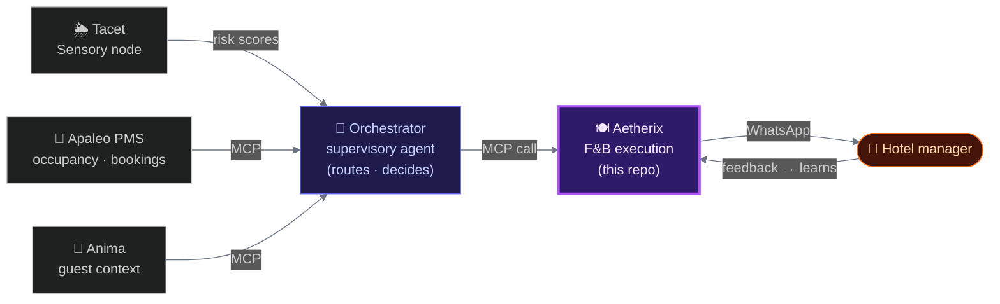
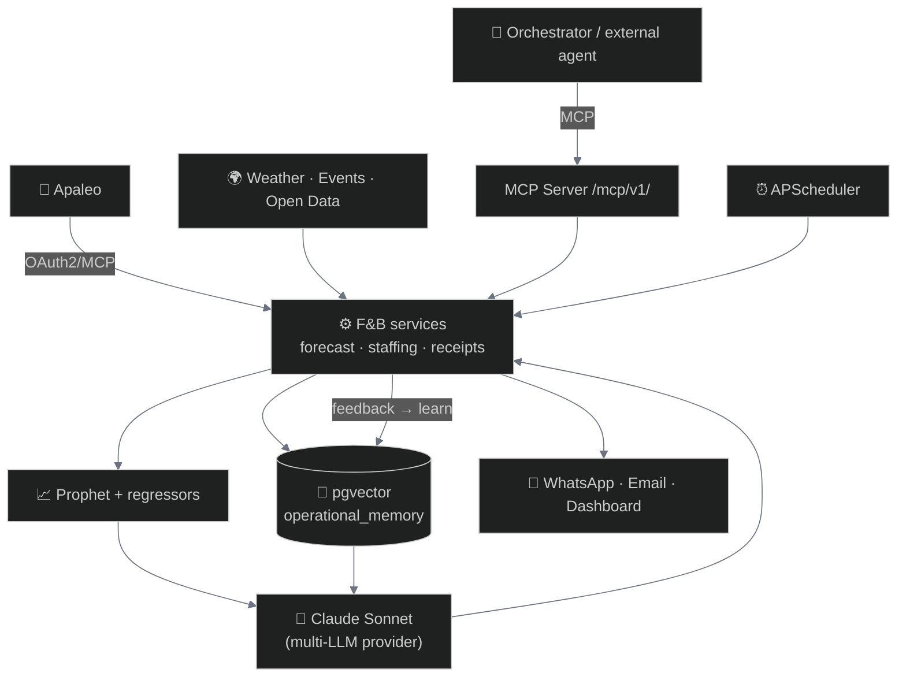

<h1 align="center">Aetherix</h1>
<p align="center">
  <em>The F&B execution node of the Hospitality Agentic Mesh.</em><br/>
  <strong>It tells a hotel manager how many covers to expect tomorrow — and how to staff for them.</strong>
</p>

<p align="center">
  
  
  
  
  
  
  
  
</p>

---

## What a manager actually gets

Every morning at 6am, one message lands on WhatsApp. No dashboard to open, no report to read.

```
☀️  Daily Receipt — Tuesday          (illustrative)

   Breakfast    84 covers   ·  confidence 88%
                72 rooms booked + 12 typical Tue walk-ins
                Staff: 4 FOH  (you ran 3 last Tue → 1 understaffing flag)

   Driver       local conference check-ins + clear weather
   Last week    forecast 79 · actual 81 · MAPE 2.5%

   Reply  ✅ accept   ✏️ modify   ❌ reject
```

The manager replies in one tap. That reply — accepted, rejected, modified — is the signal Aetherix learns from. The receipt on day 90 is sharper than the one on day 7.

**Why it matters:** labor is 25–35% of F&B operating cost, and ~25% of prepared food is wasted. The data to fix this already exists in the PMS — what's missing is the *synthesis*. Aetherix builds it automatically and delivers it where managers already work.

---

## The bigger picture — the Hospitality Agentic Mesh

Aetherix is one node in a network of specialized, **MCP-native** agents that replace rigid hotel-tech monoliths with composable intelligence. Each node owns a strict bounded context and talks to the others only through MCP — no shared code.



> **The division of labor is deliberate.** Aetherix does not orchestrate and does not route. It *recommends*; the manager *validates*; the Orchestrator decides *when* to call it.

| Node | Role | Status |
|------|------|--------|
| 🍽️ **Aetherix** | F&B execution — forecasting, staffing, memory, receipts | ✅ **Live (staging)** |
| 🌦️ **Tacet** | Sensory — weather, noise, open data → structured risk scores | 🔨 Phase 3 |
| 🧭 **Orchestrator** | Supervisory — MCP routing, business rules, agentic loop | 📐 Phase 3 stub → separate repo Phase 4 |
| 💛 **Anima** | Guest context — emotional state, CRM, flight delays → profile | 🧪 PoC shipped (Anthropic hackathon, Jun 2026) · production Phase 4 (DPIA-gated) |

Full vision → [`docs/mesh-architecture.md`](docs/mesh-architecture.md)

---

## What Aetherix does

| Capability | Detail |
|------------|--------|
| **Daily forecast** | Prophet time-series + regressors (weather, events, occupancy) |
| **Staffing reco** | covers → optimal headcount, respecting labor rules |
| **Daily Receipt** | 6am WhatsApp push — actuals vs forecast, delta, confidence |
| **Weekly digest** | Sunday KPI summary — acceptance rate, MAPE trend, cost variance |
| **Feedback loop** | accept / reject / modify → memory update → next forecast improves |
| **MCP Server** | atomic tools callable by any orchestration agent |
| **Apaleo** | native OAuth2 + MCP read (occupancy, reservations, history) |

**Forecast accuracy:** **15.09% MAPE** on J+1 covers (synthetic backtest) — under our internal 22% gate. Real-world measurement begins with the Phase 3 design partner.

### MCP tools (callable by any agent)

```jsonc
get_operational_predictions(target_date, service_type, context)
  → { prediction: { covers, confidence }, staffing, reasoning }

recall_memory(query, k_memory)            // v1 — split from the v0 combined tool
  → { memory_hits, reasoning_summary }

submit_feedback_to_memory(recommendation_id, outcome, notes)
  → { memory_id, status }
```

> `hotel_id` is **never** a tool parameter — it's resolved server-side from a per-hotel bearer token. Multi-tenant isolation by design.

---

## How it works

<details>
<summary><strong>Intelligence stack (click to expand)</strong></summary>


</details>

### Stack

| Layer | Tech | Notes |
|-------|------|-------|
| Backend | FastAPI · Python 3.12 | async, Pydantic v2 |
| Forecast | Prophet (Meta) | time-series + weather/event regressors |
| Memory | pgvector (Supabase) | Mistral 1024d embeddings, HNSW |
| LLM | Claude Sonnet | swappable via `LLMProvider` abstraction |
| Cache | Redis (Upstash) | session state, rate limiting |
| PMS | Apaleo | OAuth2 + MCP read |
| Delivery | WhatsApp (Twilio) · Email (SendGrid) | push-first, inbound feedback parser |
| Deploy | Fly.io (Paris · cdg) | Docker + uv, always-on |
| Database | Supabase (PostgreSQL) | RLS on 14 tables, EU (Stockholm) |

### Memory — the agent learns your property

- **Private Memory (per-hotel)** — every interaction becomes a signal. Over weeks the agent learns *this* hotel's patterns: which Saturdays are exceptional, which corporate clients spike room-service, which events the manager over-staffs.
- **HiveMemory (cross-hotel · announced Phase 3 → ship Phase 4)** — a new hotel starts Day-1 calibrated by similar properties, not a blank slate. Raw data stays in each tenant; only anonymized patterns travel.
- **Context Graph (Phase 4)** — explicit operational relationships (`hotel × event × weather × outcome`), Postgres-native — foundation for cohort matching v2 and the Anima node.

---

## Built to be trusted

**Evaluation as a contract, not an afterthought.** Inspired by Qonto's *"working vs reliable"* framework: a versioned golden dataset and per-layer failure thresholds define what *"bad output"* means **before** code is written. Any change to forecasting, providers, memory, or prompts needs updated examples + a green eval pipeline to merge — a hard CI gate.

| Dimension | Question answered before every ship |
|-----------|-------------------------------------|
| Edge behavior | Tested on out-of-distribution inputs, not just the happy path? |
| Graceful degradation | Does it say *"I don't know"* when uncertain — or improvise? |
| Observability | Can we see what the model actually did in production? |
| Reproducibility | Same input tomorrow → same output? |
| Distribution shift | Are we alerted when production drifts from training? |

### Security

| Area | Approach |
|------|----------|
| Multi-tenant | `hotel_id` scoped at every layer: RLS, Python guards, MCP token binding |
| MCP auth | Opaque bearer per hotel · `hotel_id` resolved server-side, never an input |
| PMS access | Read-only (Apaleo Phase 0) · all agent actions logged |
| GDPR | Supabase EU · HiveMemory = anonymized aggregates only |

---

## Status & roadmap

| Gate | Result |
|------|--------|
| Forecasting harness (Prophet + regressors) | ✅ Built |
| MCP Server | ✅ Shipped — `/mcp/`, atomic tools |
| Staging deploy | ✅ Live — `aetherix-backend.fly.dev` |
| Apaleo · Daily Receipt · WhatsApp | ✅ End-to-end |
| RLS security | ✅ 14/14 tables |
| Real-world MAPE · first design partner | 🔨 Phase 3 in progress |

| Phase | Status | Highlights |
|-------|--------|------------|
| 0 — Validation harness | ✅ | Backtest pipeline · MCP Server · staging live |
| 1 — Observability | ✅ | action log · rate-limiter · memory instrumentation |
| 2 — Receipts | ✅ | Daily Receipt · WhatsApp · inbound feedback · weekly digest |
| 3 — Pilot | 🔨 | Design partner · Orchestrator separation · HiveMemory algorithm |
| 4 — Scale | 📋 | Mews · POS ingestion · Federated HiveMemory · Context Graph · Anima |

Architecture decisions (24 documented) → [`docs/context/decisions-architecturales.md`](docs/context/decisions-architecturales.md) · Roadmap → [Linear](https://linear.app/hospitalityagent/team/HOS/all)

---

<p align="center">
  <em>Built with ❤️ for hotels, restaurants, and those who love them — by Ivan de Murard</em>
</p>
