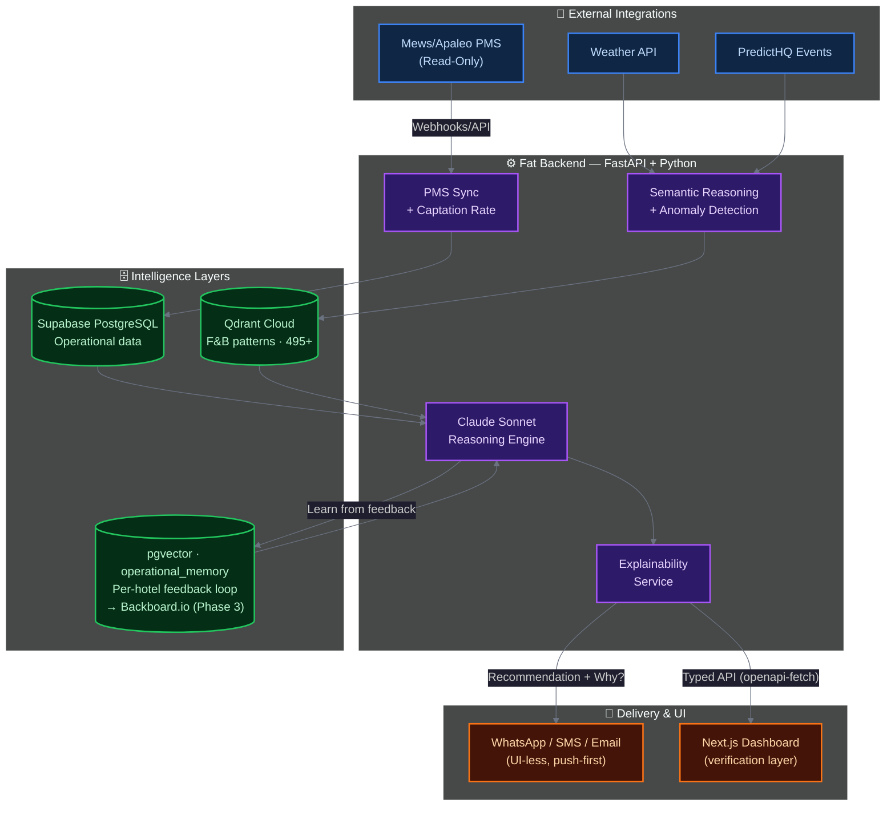

<h1 align="center">Aetherix</h1>
<p align="center">
  <em>Helping Hotel Managers predict their property's operational needs.</em>
</p>

<p align="center">
  
  
  
  
  
  
  
  
</p>

---

## Overview

**Aetherix is a proactive Agentic Layer for Hospitality Operations.**
*An intelligent, push-first and UI-less copilot that helps F&B and Operations Managers in hotels make better decisions, without another dashboard.*

Aetherix quickly adapts to a client's IT stack, uses a proactive, UI-less "push" model, and delivers the right insights at the right time.
It synthesizes internal context and property data (occupancy, capture rate, bookings, PMS, POS, ...) with external context (events, weather, social media reputation) using a semantic layer.

---

### Why Aetherix exists

Hotels waste ~25% of food produced and labor costs represent 30-45% of operating expenses. F&B and Staff prediction remains a complex and repetitive process.
Aetherix delivers **contextual, explainable recommendations** directly via WhatsApp at the right moment, learns from each property’s reality, and improves over time.

**Key insight:** The agent models each property's historical capture rate and applies contextual demand to generate recommendations that align with each property's reality.

**The result:** Contextualized intelligence, helping reduce food waste (hotels waste ~25% of food produced), labor costs, and, most importantly, giving more time to managers to focus on their customers.

---

### Core Value Proposition

| Feature | Aetherix (Proactive "Push") |
| :--- | :--- |
| **Push-first & UI-less** | Proactive alerts via Slack, WhatsApp, or else |
| **Forecasting** | Contextualized ML/LLM predictions calibrated per property |
| **Conversational Explainability** | Delivers clear and structured operational directives|
| **Context** | Synthesizes internal + external data |
| **Demand modeling** | Property-specific capture rate + anonymized cross-property patterns (hive) |
| **Integration model** | Additive layer on top of existing tools |
| **Feedback-loop** | Self-improving idiosyncratic intelligence |

****Built with real hospitality constraints in mind: high uncertainty, human decisions, and a need for trust.****
---

## Key Features & Innovation

*   **Semantic Reasoning Engine:** Translation of external data into specific, high-ROI operational directives (revenue opportunity vs. labor cost). 
*   **Conversational Receipts:** If a manager questions a recommendation, Aetherix responds instantly with a clear and immediately scannable data-driven breakdown. Trust is built by clearly explaining contextualised business decisions in an adapted user language.
*   **Property-Calibrated Demand Modeling:** Aetherix learns each property's real capture rate (% of in-house guests who dine on-site), not a theoretical industry ratio. The model adapts over time.
*   **Painless Pilot & 1-Way Sync:** Designed for zero-friction integration. Aetherix requires only a read-only webhook/API key from legacy or modern PMS systems (Mews, Apaleo, etc.) to establish baselines.

---

## Building with the BMAD Methodology

Aetherix is conceived, structured, and validated using the rigorous **BMAD (Business, Market, Architecture, Design)** methodology.
This ensures the project is not just a technical proof-of-concept, but a viable Agentic AI product.

*   **Business Justification:** Clear financial ROI and metrics for success (e.g., Target MAPE < 15%, Labor Cost reduction).
*   **Domain Compliance:** Explicit architectural decisions to handle GDPR (anonymized PII) and European Labor Laws (calculating penalty pay into recommendations).
*   **Traceable Architecture:** Documented logic separating business requirements from technical implementation layers.

Roadmap hosted on [Linear](https://linear.app/hospitalityagent/team/HOS/all)
---

### Current Status (April 2026)

- Native Apaleo integration (OAuth + MCP-compatible read-only access)
- End-to-end agentic pipeline: Prophet forecasting + pgvector retrieval + Backboard memory + Claude reasoning
- Daily push recommendations (F&B covers + staffing + prep)
- Conversational feedback loop ("Why?", "What if?", outcomes)
- Self-improving per-hotel intelligence

---
## Architecture & Technical Strategy

The architecture adheres to a strict "Thin Frontend / Fat Backend" philosophy. The intelligence stack has four distinct layers working in sequence to produce a single actionable recommendation.



### The Four Intelligence Layers

| Layer | Technology | Role |
| :--- | :--- | :--- |
| **1. Numerical Forecast** | Prophet (time-series) | Predicts covers volume from PMS + occupancy + regressors |
| **2. Semantic Patterns** | Qdrant Cloud (495+ vectors) | Matches current context against similar historical service scenarios |
| **3. Cognitive Memory** | pgvector → Backboard.io (Ph. 3) | Two-layer design. **1. Private Memory** (per hotel, Phase 0–1): ultra-specific idiosyncrasies - what works *only* for this property (real capture rate, manager preferences, non-generalizable local patterns). **2. Hive Memory** (anonymized cross-hotel, Phase 3 via Backboard): patterns grouped by tags (city/resort/airport, clientele type, segment, restaurant size) - enriches predictions with cross-property proof of impact. Each hotel benefits from its own learning *and* collective wisdom, never sharing raw data. |
| **4. Reasoning & Explanation** | Claude Sonnet (Anthropic) | Synthesizes the three layers into a directive with natural-language explanation |

### Tech Stack

| Layer | Technologies | Purpose |
| :--- | :--- | :--- |
| **Frontend (UI)** | Next.js (App Router), Tailwind CSS, shadcn/ui | Verification and oversight layer — not the primary interaction surface |
| **Backend (AI/Logic)** | Python, FastAPI, APScheduler | LLM orchestration, async jobs, push dispatch |
| **Operational DB** | Supabase (PostgreSQL) + RLS | Multi-tenant data isolation, actuals tracking |
| **Pattern Store** | Qdrant Cloud | Vector similarity search for F&B scenario patterns |
| **Cognitive Memory** | pgvector `operational_memory` → Backboard.io (Ph. 3) | Phase 0–1: per-hotel feedback loop via `MemoryProvider` interface. Phase 3: Backboard adds structured insights + anonymized cross-hotel pattern generalization (by segment, location, clientele type). |
| **Delivery** | Twilio (WhatsApp/SMS), SendGrid | UI-less push notifications; inbound "Why?" reply handling |
| **Client-Server Contract** | OpenAPI, `openapi-fetch` | End-to-end type safety |

---

## Project Structure

```text
aetherix/
├── backend/                 # FastAPI — AI orchestration & business logic
│   └── app/
│       ├── api/             # HTTP routes (auth, pms, predictions, reports)
│       ├── db/              # PostgreSQL models & session
│       ├── services/        # Reasoning engine, RAG, PMS sync, WhatsApp…
│       └── integrations/    # External tools: Obsidian (knowledge base), Linear (issues)
├── frontend/                # Next.js App Router UI
│   └── src/
│       ├── app/             # Pages: dashboard, settings, auth
│       ├── components/      # shadcn/ui + feature components
│       └── lib/             # openapi-fetch generated API client
├── docs/                    # Architecture, roadmap, BMAD methodology
├── scripts/                 # Dev & ops utility scripts
├── supabase/                # DB migrations
├── local-shared-data/       # OpenAPI spec shared between backend & frontend
├── docker-compose.yml       # Local dev: backend + frontend + postgres + mailhog
└── archive/                 # Legacy code (pre-FastAPI era) — not used in production
```

---

## Security

Aetherix is designed with security and data isolation as first-class constraints, not afterthoughts. This is particularly important given the platform's multi-tenant nature and its integration with live PMS systems.

| Area | Approach |
| :--- | :--- |
| **Multi-tenant isolation** | Each hotel's data is strictly scoped by `hotel_id` at every layer: Supabase Row-Level Security (RLS), service-layer enforcement, and vector store namespace separation. No cross-hotel data access by design. |
| **Read-only PMS access** | Aetherix operates in read-only mode against PMS systems (Apaleo, ...). The agent never writes to or modifies reservation or guest data. This is an architectural constraint, not just a convention. |
| **Agent action logging** | Every AI-driven action is logged with full context (hotel, model invocation, tool calls, outcomes). Human-in-the-loop by default: the agent recommends, the manager decides. |
| **Credential management** | API keys and secrets are managed via environment variables, never hardcoded. OAuth2 flows follow provider standards (Apaleo OAuth2). Webhook endpoints validate inbound signatures (Twilio, PMS providers). |
| **LLM input scoping** | Claude prompts are scoped to the requesting hotel's context. Recommendations are generated per-property and never cross-contaminate tenant data. Manager replies passed to the LLM are sanitized against prompt injection. |
| **GDPR / data minimization** | Hotel operational data is stored in Supabase (EU-compatible infrastructure). Hive Memory (Phase 3) aggregates patterns in anonymized, non-attributable form; no raw hotel data is ever shared across tenants. PII is minimized by design. |

> A formal security review will be conducted before any live deployment with real property data, and before any Agent Hub listing.

---
Made with ❤️ for hotels, restaurants, and those who love them. Ivan de Murard
---
*Aetherix - Contextual Intelligence for Hospitality Operations.*
