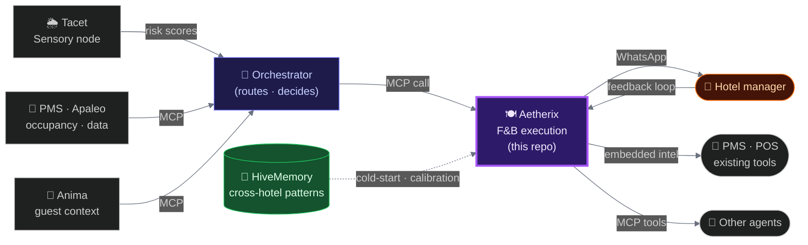

<h1 align="center">Aetherix</h1>
<p align="center">
  <em>The F&B execution node of the Hospitality Agentic Mesh.</em><br/>
  <strong>It tells a hotel manager how many covers to expect tomorrow, how to staff for them, and how to cut food waste.</strong>
</p>

<p align="center">
  
  
  
  
  
  
  
  
</p>

---

## What Aetherix is

Aetherix is the F&B execution node of the **Hospitality Agentic Mesh**: a network of specialized AI agents that communicate via MCP (Model Context Protocol) and deliver intelligence where hotel operators already work.

It owns one domain with precision: forecasting F&B covers, optimizing staffing, and sending actionable recommendations to hotel managers. It learns from each property's history, adapts continuously through manager feedback, and exposes its capabilities as MCP tools callable by any orchestration agent.

**Aetherix does not orchestrate. It recommends. The manager validates.**

The separation is intentional: each node in the Mesh has a strict bounded context. Aetherix owns F&B. An Orchestrator decides when to call it.

---

## Why it exists

**Problem:** F&B demand anticipation remains a daily, manual, error-prone process. Hotels rely on limited data, disconnected tools, and Excel sheets. As a result, a significant share of purchased food is wasted; labor accounts for 25-35% of F&B operating costs; and over- or understaffing hits both employee and guest experience.

**Key insight:** The bottleneck is not data. Hotels have PMS data. The bottleneck is synthesis: combining internal context (occupancy, capture rates, POS history) with external signals (weather, local events) into a recommendation calibrated to *this* property's reality.

Aetherix builds that synthesis automatically, learns from manager feedback, and delivers it where managers already work: via WhatsApp, embedded in existing PMS and POS tools, or callable via MCP by other agents. **Glue, not replacement.**

---

## What changes

After 90 days on a live property:

| Outcome | Target |
|---------|--------|
| Labor cost variance | -3% to -8% |
| Food waste per cover | Tracked and declining |
| Planning time | From hours to one validated message |
| Forecast accuracy (J+1) | 15.09% MAPE (synthetic backtest, 22% gate PASS) |

**The system learns your property.** On Day 1, Aetherix ingests your PMS and POS history and starts calibrating to your property's real patterns immediately. Where historical data is sparse (new property, new service, no POS yet), HiveMemory fills the gap with anonymized patterns from similar properties in the Mesh — without sharing raw data. By Day 90, the system knows yours specifically: which Saturdays spike, which corporate clients drive room service, which events the manager always over-staffs for.

---

## What the manager sees

Ahead of a conference wave, a stormy weekend, or a Friday with three competing events in the neighborhood, a message lands on the manager's phone. No dashboard to open, no report to read.

```
Breakfast    84 covers   ·  confidence 88%        (illustrative)
             72 rooms booked + 12 typical Tue walk-ins
             Staff: 4 FOH  (you ran 3 last Tue → 1 understaffing flag)

Driver       local conference check-ins + clear weather
Last week    forecast 79 · actual 81 · MAPE 2.5%

Reply  ✅ accept   ✏️ modify   ❌ reject
```

The manager replies in one tap. That reply (accepted, rejected, modified) is the signal Aetherix learns from. The receipt on day 90 is sharper than the one on day 7.

---

## The Hospitality Agentic Mesh

Aetherix is one node in a network of specialized, MCP-native agents. Each node owns a strict bounded context and communicates only through MCP. No shared code, no monolith to displace.



| Node | Role | Status |
|------|------|--------|
| 🍽️ **Aetherix** | F&B execution: forecasting, staffing, memory, receipts | ✅ **Live (staging)** |
| 🌦️ **Tacet** | Sensory: weather, noise, open data, structured risk scores | 🔨 Phase 3 |
| 🧭 **Orchestrator** | Supervisory: MCP routing, business rules, agentic loop | 📐 Phase 3 stub, separate repo Phase 4 |
| 💛 **Anima** | Guest context: emotional state, CRM, flight delays, profile | 🧪 PoC shipped (Anthropic hackathon, Jun 2026) · production Phase 4 (DPIA-gated) |

Full vision: [`docs/mesh-architecture.md`](docs/mesh-architecture.md)

---

## What Aetherix does

| Capability | Detail |
|------------|--------|
| **Forecast** | Prophet time-series + regressors (weather, events, occupancy) |
| **Staffing reco** | Covers to optimal headcount, respecting labor rules |
| **Proactive receipt** | Anticipatory WhatsApp push: actuals vs forecast, delta, confidence |
| **Weekly digest** | Sunday KPI summary: acceptance rate, MAPE trend, cost variance |
| **Feedback loop** | Accept / reject / modify triggers memory update; next forecast improves |
| **MCP Server** | Atomic tools callable by any orchestration agent |
| **Apaleo** | Native OAuth2 + MCP read (occupancy, reservations, history) |

**Forecast accuracy:** **15.09% MAPE** on J+1 covers (synthetic backtest, under our 22% internal gate). Real-world measurement begins with the Phase 3 design partner.

### MCP tools (callable by any agent)

```jsonc
get_operational_predictions(target_date, service_type, context)
  → { prediction: { covers, confidence }, staffing, reasoning }

recall_memory(query, k_memory)            // v1 — split from the v0 combined tool
  → { memory_hits, reasoning_summary }

submit_feedback_to_memory(recommendation_id, outcome, notes)
  → { memory_id, status }
```

> `hotel_id` is **never** a tool parameter — it is resolved server-side from a per-hotel bearer token. Multi-tenant isolation by design.

---

## How it works

<details>
<summary><strong>Agentic pipeline (click to expand)</strong></summary>


</details>

### Stack

| Layer | Tech | Notes |
|-------|------|-------|
| Backend | FastAPI · Python 3.12 | Async, Pydantic v2 |
| Forecast | Prophet (Meta) | Time-series + weather/event regressors |
| Memory | pgvector (Supabase) | Mistral 1024d embeddings, HNSW |
| LLM | Claude Sonnet | Swappable via `LLMProvider`: automatic fallback to Gemini or GPT without code changes |
| Cache | Redis (Upstash) | Session state, rate limiting |
| PMS | Apaleo | OAuth2 + MCP read |
| Delivery | WhatsApp (Twilio) · Email (SendGrid) · embedded PMS/POS | Push-first, inbound feedback parser |
| Deploy | Fly.io (Paris · cdg) | Docker + uv, always-on |
| Database | Supabase (PostgreSQL) | RLS on 14 tables, EU (Stockholm) |

---

## Built to be trusted

**Evaluation as a contract, not an afterthought.** Inspired by Qonto's *"working vs reliable"* framework: a versioned golden dataset and per-layer failure thresholds define what *"bad output"* means before code is written. Any change to forecasting, providers, memory, or prompts needs updated examples and a green eval pipeline to merge — a hard CI gate.

| Dimension | Question answered before every ship |
|-----------|-------------------------------------|
| Edge behavior | Tested on out-of-distribution inputs, not just the happy path? |
| Graceful degradation | Does it say *"I don't know"* when uncertain, or improvise? |
| Observability | Can we see what the model actually did in production? |
| Reproducibility | Same input tomorrow, same output? |
| Distribution shift | Are we alerted when production drifts from training? |

### Security

| Area | Approach |
|------|----------|
| Multi-tenant | `hotel_id` scoped at every layer: RLS, Python guards, MCP token binding |
| MCP auth | Opaque bearer per hotel · `hotel_id` resolved server-side, never an input |
| PMS access | Read-only (Apaleo Phase 0) · all agent actions logged |
| GDPR | Supabase EU · HiveMemory = anonymized aggregates only |

---

## Status & roadmap

| Gate | Result |
|------|--------|
| Forecasting harness (Prophet + regressors) | ✅ Built |
| MCP Server | ✅ Shipped: `/mcp/`, atomic tools |
| Staging deploy | ✅ Live: `aetherix-backend.fly.dev` |
| Apaleo · Daily Receipt · WhatsApp | ✅ End-to-end |
| RLS security | ✅ 14/14 tables |
| Real-world MAPE · first design partner | 🔨 Phase 3 in progress |

| Phase | Status | Highlights |
|-------|--------|------------|
| 0 — Validation harness | ✅ | Backtest pipeline · MCP Server · staging live |
| 1 — Observability | ✅ | Action log · rate-limiter · memory instrumentation |
| 2 — Receipts | ✅ | Daily Receipt · WhatsApp · inbound feedback · weekly digest |
| 3 — Pilot | 🔨 | Design partner · Orchestrator separation · HiveMemory algorithm |
| 4 — Scale | 📋 | Mews · POS ingestion · Federated HiveMemory · Context Graph · Anima |

Architecture decisions (25 documented): [`docs/context/decisions-architecturales.md`](docs/context/decisions-architecturales.md) · Roadmap: [Linear](https://linear.app/hospitalityagent/team/HOS/all)

---

<p align="center">
  <em>Built with ❤️ for hotels, restaurants, and those who love them — by Ivan de Murard</em>
</p>
