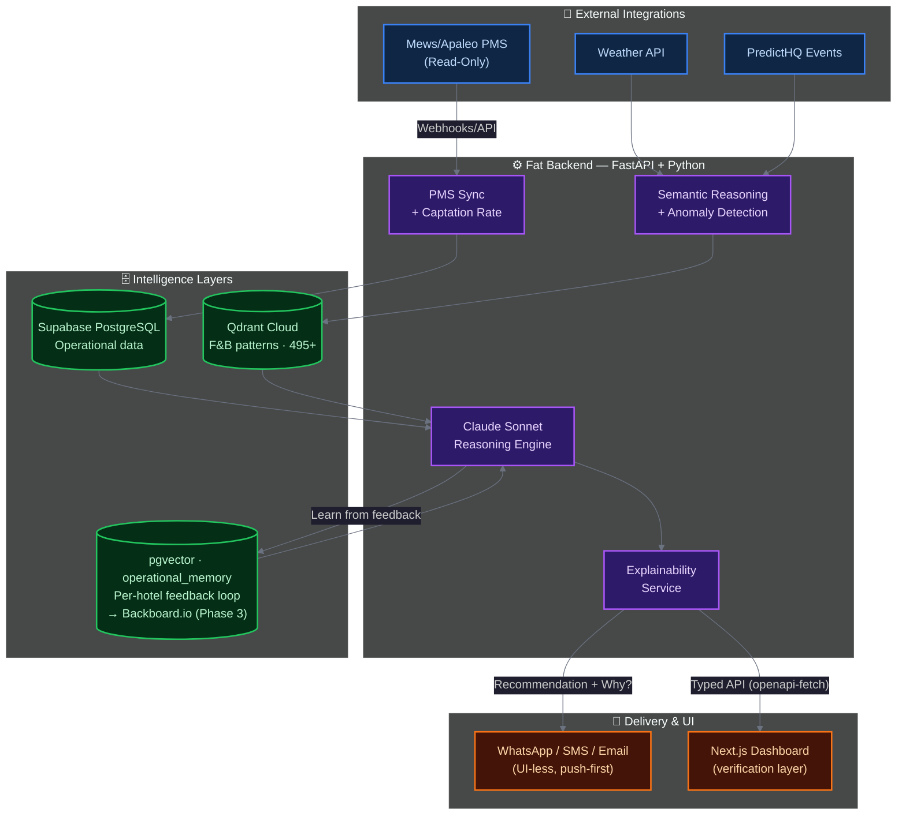

<h1 align="center">Aetherix</h1>
<p align="center">
  <em>Helping Hotel Managers predict their property's operational needs.</em>
</p>

<p align="center">
  
  
  
  
  
  
  
  
</p>

---

## Overview

**Aetherix is a proactive Agentic Intelligence Layer for Hospitality Operations.**

It functions as a **UI-less, push-first copilot** that delivers contextualized F&B covers, staffing, and prep recommendations directly to operations teams. 

Aetherix synthesizes PMS data, property-specific capture rates, and external signals (weather, events, etc.) through a multi-layer memory-and-reasoning system.
It is designed from the ground up to be **easy to integrate** into existing hotel tech stacks and **callable by other agents** via MCP.

---

### Why Aetherix exists

Hotels waste ~25% of the food they produce, and labor costs represent 30-45% of operating expenses. Accurate daily operational forecasting remains manual, repetitive, and error-prone.

Aetherix delivers **contextual, explainable recommendations** via WhatsApp (or other channels) at the right moment, learns each property’s unique reality, and improves over time through feedback.

**Key insight:** By modeling each property’s real historical capture rates and enriching them with contextual demand signals, Aetherix generates recommendations that actually fit the hotel’s reality.

**Goal:** Reduce food waste and labor inefficiencies while giving managers more time to focus on their guests.

---

### Why Aetherix exists

Hotels waste ~25% of food produced and labor costs represent 30-45% of operating expenses. F&B and Staff prediction remains a complex and repetitive process.
Aetherix delivers **contextual, explainable recommendations** directly via WhatsApp at the right moment, learns from each property’s reality, and improves over time.

**Key insight:** The agent models each property's historical capture rate and applies contextual demand to generate recommendations that align with each property's reality.

**The result:** Contextualized intelligence, helping reduce food waste (hotels waste ~25% of food produced), labor costs, and, most importantly, giving more time to managers to focus on their customers.

---

### Core Value Proposition

| Feature                    | Aetherix (Proactive & Headless)                  |
|---------------------------|--------------------------------------------------|
| **Delivery**              | Push-first (WhatsApp/Slack/etc.) + MCP callable |
| **Forecasting**           | Contextual ML/LLM predictions per property       |
| **Explainability**        | Conversational, structured breakdowns            |
| **Memory**                | Idiosyncratic (per-hotel) + Hive (anonymized cross-property) |
| **Integration**           | Additive layer on top of PMS; MCP inbound/outbound |
| **Feedback Loop**         | Self-improving via manager overrides             |

Built with real hospitality constraints in mind: high uncertainty, human oversight, GDPR, and labor regulations.

---

## Key Features & Innovation

- **Property-Calibrated Demand Modeling**: Learns actual capture rates per hotel. The model improves over time.
- **Two-Layer Memory System**: Private idiosyncratic memory + anonymized hive intelligence grouped by metadata (size, type, location, customers, ...).
- **Conversational Explainability**: Managers can challenge recommendations and get an immediate, scannable, data-driven reasoning breakdown.
- **Headless-First Design**: UI-less core with optional verification dashboard. Exposes capabilities as MCP tools so other agents can consume predictions at scale.
- **Painless Integration**: Designed for zero-friction integration. Aetherix requires only a read-only access via webhooks, API keys, or Apaleo MCP.

---

## Current Status (April 2026)

- Native Apaleo integration (OAuth + MCP-compatible read access)
- End-to-end pipeline: Prophet forecasting + semantic patterns (Qdrant) + memory layers + Claude Sonnet reasoning
- Daily proactive recommendations (F&B covers, staffing, prep)
- Conversational feedback loop with memory updates
- Outbound MCP Server in progress (making Aetherix callable by orchestration agents)

**Note**: This is a side project / portfolio piece currently in validation phase with sandbox + synthetic data. No live hotel pilots yet.

---

## Building with the BMAD Methodology

Aetherix is conceived, structured, and validated using the rigorous **BMAD (Business, Market, Architecture, Design)** methodology.
This helps ensure the project is not just a technical proof-of-concept, but a viable Agentic AI product.

*   **Business Justification:** Clear financial ROI and metrics for success (e.g., Target MAPE < 15%, Labor Cost reduction).
*   **Domain Compliance:** Explicit architectural decisions to handle GDPR (anonymized PII) and European Labor Laws (calculating penalty pay into recommendations).
*   **Traceable Architecture:** Documented logic separating business requirements from technical implementation layers.

**Roadmap:** hosted on [Linear](https://linear.app/hospitalityagent/team/HOS/all)

**Immediate priorities**:
- Complete MCP data orchestration + backtesting with defined KPIs (MAPE <15%, etc.)
- Ship minimal outbound Aetherix MCP Server so other agents can call predictions and memory-enriched insights
- Transparent validation results (sandbox/synthetic)
---

## Architecture & Technical Strategy

The architecture adheres to a strict "Thin Frontend / Fat Backend" philosophy. The intelligence stack has four distinct layers working in sequence to produce a single actionable recommendation.



### The Four Intelligence Layers

| Layer                  | Technology                  | Role |
|------------------------|-----------------------------|------|
| **1. Numerical Forecast** | Prophet (time-series)      | Base volume predictions from PMS + regressors |
| **2. Semantic Patterns**  | Qdrant Cloud               | Context matching against historical scenarios |
| **3. Cognitive Memory**   | pgvector → Backboard.io (Ph. 3) | Two-layer: Private (idiosyncratic) + Hive (anonymized, metadata-grouped) |
| **4. Reasoning & Explanation** | Claude Sonnet (Anthropic)  | Synthesizes everything into actionable, explainable recommendations |

### Tech Stack

| Layer | Technologies | Purpose |
| :--- | :--- | :--- |
| **Frontend (UI)** | Next.js (App Router), Tailwind CSS, shadcn/ui | Human in the Loop - Verification and oversight layer |
| **Backend (AI/Logic)** | Python, FastAPI, APScheduler | LLM orchestration, async jobs, push dispatch |
| **Operational DB** | Supabase (PostgreSQL) + RLS | Multi-tenant data isolation, actuals tracking |
| **Pattern Store** | Qdrant Cloud | Vector similarity search for F&B scenario patterns |
| **Cognitive Memory** | pgvector `operational_memory` → Backboard.io (Ph. 3) | Phase 0–1: per-hotel feedback loop via `MemoryProvider` interface. Phase 3: Backboard adds structured insights + anonymized cross-hotel pattern generalization (by segment, location, clientele type). |
| **Delivery** | Twilio (WhatsApp/SMS), SendGrid | UI-less push notifications; inbound "Why?" reply handling |
| **Client-Server Contract** | OpenAPI, `openapi-fetch` | End-to-end type safety |

---

## Project Structure

```text
aetherix/
├── backend/                 # FastAPI — AI orchestration & business logic
│   └── app/
│       ├── api/             # HTTP routes (auth, pms, predictions, reports)
│       ├── db/              # PostgreSQL models & session
│       ├── services/        # Reasoning engine, RAG, PMS sync, WhatsApp…
│       └── integrations/    # External tools: Obsidian (knowledge base), Linear (issues)
├── frontend/                # Next.js App Router UI
│   └── src/
│       ├── app/             # Pages: dashboard, settings, auth
│       ├── components/      # shadcn/ui + feature components
│       └── lib/             # openapi-fetch generated API client
├── docs/                    # Architecture, roadmap, BMAD methodology
├── scripts/                 # Dev & ops utility scripts
├── supabase/                # DB migrations
├── local-shared-data/       # OpenAPI spec shared between backend & frontend
├── docker-compose.yml       # Local dev: backend + frontend + postgres + mailhog
└── archive/                 # Legacy code (pre-FastAPI era) — not used in production
```

---

## Security

Aetherix is designed with security and data isolation as first-class constraints, not afterthoughts. This is particularly important given the platform's multi-tenant nature and its integration with live PMS systems.

| Area | Approach |
| :--- | :--- |
| **Multi-tenant isolation** | Each hotel's data is strictly scoped by `hotel_id` at every layer: Supabase Row-Level Security (RLS), service-layer enforcement, and vector store namespace separation. No cross-hotel data access by design. |
| **Read-only PMS access** | Aetherix operates in read-only mode against PMS systems (Apaleo, ...). The agent never writes to or modifies reservation or guest data. This is an architectural constraint, not just a convention. |
| **Agent action logging** | Every AI-driven action is logged with full context (hotel, model invocation, tool calls, outcomes). Human-in-the-loop by default: the agent recommends, the manager decides. |
| **Credential management** | API keys and secrets are managed via environment variables, never hardcoded. OAuth2 flows follow provider standards (Apaleo OAuth2). Webhook endpoints validate inbound signatures (Twilio, PMS providers). |
| **LLM input scoping** | Claude prompts are scoped to the requesting hotel's context. Recommendations are generated per-property and never cross-contaminate tenant data. Manager replies passed to the LLM are sanitized against prompt injection. |
| **GDPR / data minimization** | Hotel operational data is stored in Supabase (EU-compatible infrastructure). Hive Memory (Phase 3) aggregates patterns in anonymized, non-attributable form; no raw hotel data is ever shared across tenants. PII is minimized by design. |

> A formal security review would be conducted before any live deployment and before any Agent Hub listing.

---

## Philosophy

Aetherix is built to be part of an **agent mesh** in hospitality, and to not be just a new tool for human managers, but also a **MCP callable capability** that other agents (orchestration, revenue, procurement, etc.) can invoke at scale. Agent-to-Agent intelligence leveraging made possible. 

---

## Vision for the Future

<svg width="680" height="612" viewBox="0 0 680 612" xmlns="http://www.w3.org/2000/svg">
<rect width="680" height="600" fill="#ffffff"/>

<!-- DELIVERY RING SECTORS (r=172 to r=215) -->
<path d="M 330 93 L 330 50 A 215 215 0 0 1 516 372 L 479 351 A 172 172 0 0 0 330 93 Z" fill="#9FE1CB"/>
<path d="M 479 351 L 516 372 A 215 215 0 0 1 144 372 L 181 351 A 172 172 0 0 0 479 351 Z" fill="#D3D1C7"/>
<path d="M 181 351 L 144 372 A 215 215 0 0 1 330 50 L 330 93 A 172 172 0 0 0 181 351 Z" fill="#D3D1C7"/>

<!-- AGENT RING SECTORS (r=95 to r=172) -->
<path d="M 330 170 L 330 93 A 172 172 0 0 1 479 351 L 412 312 A 95 95 0 0 0 330 170 Z" fill="#1D9E75"/>
<path d="M 412 312 L 479 351 A 172 172 0 0 1 181 351 L 248 312 A 95 95 0 0 0 412 312 Z" fill="#888780"/>
<path d="M 248 312 L 181 351 A 172 172 0 0 1 330 93 L 330 170 A 95 95 0 0 0 248 312 Z" fill="#888780"/>

<!-- DATA ACCESS RING (r=48 to r=95) -->
<circle cx="330" cy="265" r="95" fill="#185FA5"/>

<!-- HOTEL CENTER -->
<circle cx="330" cy="265" r="48" fill="#F1EFE8" stroke="#888780" stroke-width="0.5"/>

<!-- HUMAN IN THE LOOP: full amber ring at agent-delivery boundary (r=172) -->
<circle cx="330" cy="265" r="172" fill="none" stroke="#EF9F27" stroke-width="5"/>

<!-- RING BORDERS -->
<circle cx="330" cy="265" r="215" fill="none" stroke="#B4B2A9" stroke-width="0.5"/>
<circle cx="330" cy="265" r="172" fill="none" stroke="#ffffff" stroke-width="0.5"/>
<circle cx="330" cy="265" r="95"  fill="none" stroke="#0C447C" stroke-width="0.5"/>
<circle cx="330" cy="265" r="48"  fill="none" stroke="#888780" stroke-width="0.5"/>

<!-- SECTOR DIVIDER LINES (white, spanning agent and delivery rings) -->
<line x1="330" y1="170" x2="330" y2="50"  stroke="#ffffff" stroke-width="1.5"/>
<line x1="412" y1="312" x2="516" y2="372" stroke="#ffffff" stroke-width="1.5"/>
<line x1="248" y1="312" x2="144" y2="372" stroke="#ffffff" stroke-width="1.5"/>

<!-- MCP CONNECTIVITY DOTS at r=95 boundary (8 points, offset from dividers) -->
<circle cx="366" cy="177" r="3.5" fill="#ffffff" stroke="#0C447C" stroke-width="0.5"/>
<circle cx="418" cy="228" r="3.5" fill="#ffffff" stroke="#0C447C" stroke-width="0.5"/>
<circle cx="418" cy="302" r="3.5" fill="#ffffff" stroke="#0C447C" stroke-width="0.5"/>
<circle cx="366" cy="353" r="3.5" fill="#ffffff" stroke="#0C447C" stroke-width="0.5"/>
<circle cx="294" cy="353" r="3.5" fill="#ffffff" stroke="#0C447C" stroke-width="0.5"/>
<circle cx="242" cy="302" r="3.5" fill="#ffffff" stroke="#0C447C" stroke-width="0.5"/>
<circle cx="242" cy="228" r="3.5" fill="#ffffff" stroke="#0C447C" stroke-width="0.5"/>
<circle cx="294" cy="177" r="3.5" fill="#ffffff" stroke="#0C447C" stroke-width="0.5"/>

<!-- HOTEL LABEL -->
<text x="330" y="260" text-anchor="middle" font-family="Georgia, serif" font-size="13" font-weight="600" fill="#2C2C2A">Hotel</text>
<text x="330" y="274" text-anchor="middle" font-family="Georgia, serif" font-size="9" fill="#5F5E5A">Data owner</text>

<!-- DATA ACCESS RING: SYSTEM TYPE LABELS (white on blue, r=71) -->
<text x="376" y="214" text-anchor="middle" font-family="Georgia, serif" font-size="8" fill="#ffffff">PMS</text>
<text x="401" y="269" text-anchor="middle" font-family="Georgia, serif" font-size="8" fill="#ffffff">POS</text>
<text x="376" y="323" text-anchor="middle" font-family="Georgia, serif" font-size="8" fill="#ffffff">RMS</text>
<text x="284" y="323" text-anchor="middle" font-family="Georgia, serif" font-size="8" fill="#ffffff">Labor</text>
<text x="259" y="269" text-anchor="middle" font-family="Georgia, serif" font-size="8" fill="#ffffff">CRS</text>
<text x="284" y="214" text-anchor="middle" font-family="Georgia, serif" font-size="8" fill="#ffffff">Channel</text>

<!-- AGENT RING: SECTOR LABELS -->
<text x="445" y="191" text-anchor="middle" font-family="Georgia, serif" font-size="11" font-weight="600" fill="#ffffff">F&amp;B agent</text>
<text x="445" y="204" text-anchor="middle" font-family="Georgia, serif" font-size="8.5" fill="#E1F5EE">Staffing · forecasting</text>
<text x="445" y="216" text-anchor="middle" font-family="Georgia, serif" font-size="8" fill="#9FE1CB">MCP-callable</text>

<text x="330" y="391" text-anchor="middle" font-family="Georgia, serif" font-size="11" font-weight="600" fill="#2C2C2A">Revenue agent</text>
<text x="330" y="404" text-anchor="middle" font-family="Georgia, serif" font-size="8.5" fill="#444441">Pricing · demand</text>

<text x="215" y="191" text-anchor="middle" font-family="Georgia, serif" font-size="11" font-weight="600" fill="#2C2C2A">Ops agent</text>
<text x="215" y="204" text-anchor="middle" font-family="Georgia, serif" font-size="8.5" fill="#444441">Housekeeping · ops</text>

<!-- DELIVERY RING: OUTPUT LABELS -->
<text x="492" y="162" text-anchor="middle" font-family="Georgia, serif" font-size="8" fill="#085041">Scheduling</text>
<text x="492" y="173" text-anchor="middle" font-family="Georgia, serif" font-size="8" fill="#085041">&amp; Reports</text>
<text x="330" y="455" text-anchor="middle" font-family="Georgia, serif" font-size="8" fill="#444441">Rate · Demand</text>
<text x="168" y="162" text-anchor="middle" font-family="Georgia, serif" font-size="8" fill="#444441">Tasks &amp;</text>
<text x="168" y="173" text-anchor="middle" font-family="Georgia, serif" font-size="8" fill="#444441">Routing</text>

<!-- EXTERNAL ANNOTATIONS -->

<!-- Data access layer (left) -->
<circle cx="235" cy="265" r="2" fill="#185FA5"/>
<line x1="235" y1="265" x2="88" y2="232" stroke="#185FA5" stroke-width="0.5" stroke-dasharray="3 2"/>
<text x="84" y="228" text-anchor="end" font-family="Georgia, serif" font-size="9" font-weight="600" fill="#185FA5">Data access layer</text>
<text x="84" y="240" text-anchor="end" font-family="Georgia, serif" font-size="8" fill="#5F5E5A">PMS · POS · RMS · MCP</text>

<!-- Delivery layer (top right) -->
<circle cx="404" cy="63" r="2" fill="#5F5E5A"/>
<line x1="404" y1="63" x2="554" y2="55" stroke="#5F5E5A" stroke-width="0.5" stroke-dasharray="3 2"/>
<text x="558" y="59" text-anchor="start" font-family="Georgia, serif" font-size="9" fill="#5F5E5A">Delivery layer</text>

<!-- Aetherix agents (right, pointing to agent ring at angle -15deg r=165: (490, 221)) -->
<circle cx="490" cy="221" r="2" fill="#0F6E56"/>
<line x1="490" y1="221" x2="556" y2="195" stroke="#0F6E56" stroke-width="0.5" stroke-dasharray="3 2"/>
<text x="560" y="192" text-anchor="start" font-family="Georgia, serif" font-size="9" font-weight="600" fill="#0F6E56">Aetherix agents</text>
<text x="560" y="203" text-anchor="start" font-family="Georgia, serif" font-size="8" fill="#0F6E56">Intelligence layer</text>

<!-- Human in the loop (right, pointing to amber ring at angle -5deg r=172: (501, 250)) -->
<circle cx="501" cy="250" r="2" fill="#BA7517"/>
<line x1="501" y1="250" x2="556" y2="228" stroke="#BA7517" stroke-width="0.5" stroke-dasharray="3 2"/>
<text x="560" y="225" text-anchor="start" font-family="Georgia, serif" font-size="9" font-weight="600" fill="#BA7517">Human in the loop</text>
<text x="560" y="236" text-anchor="start" font-family="Georgia, serif" font-size="8" fill="#B06010">Approval gate · all agents</text>

<!-- LEGEND -->
<circle cx="48" cy="490" r="5" fill="#1D9E75"/>
<text x="58" y="494" font-family="Georgia, serif" font-size="9" fill="#5F5E5A">Live — built</text>
<circle cx="130" cy="490" r="5" fill="#888780"/>
<text x="140" y="494" font-family="Georgia, serif" font-size="9" fill="#5F5E5A">Planned — roadmap</text>
<circle cx="232" cy="490" r="5" fill="none" stroke="#EF9F27" stroke-width="2.5"/>
<text x="242" y="494" font-family="Georgia, serif" font-size="9" fill="#5F5E5A">Human in the loop</text>
<circle cx="340" cy="490" r="3.5" fill="#ffffff" stroke="#0C447C" stroke-width="0.5"/>
<text x="348" y="494" font-family="Georgia, serif" font-size="9" fill="#5F5E5A">MCP connection point</text>

<!-- ROADMAP -->
<line x1="40" y1="507" x2="640" y2="507" stroke="#D3D1C7" stroke-width="0.5"/>
<text x="40" y="521" font-family="Georgia, serif" font-size="9" font-weight="600" fill="#2C2C2A">Roadmap</text>

<circle cx="48" cy="534" r="4" fill="#1D9E75"/>
<text x="58" y="538" font-family="Georgia, serif" font-size="9" font-weight="600" fill="#2C2C2A">F&amp;B Agent — Live</text>
<text x="68" y="550" font-family="Georgia, serif" font-size="9" fill="#5F5E5A">Staffing intelligence, shift forecasting, explainable reasoning. MCP-callable.</text>

<circle cx="48" cy="563" r="4" fill="#888780"/>
<text x="58" y="567" font-family="Georgia, serif" font-size="9" font-weight="600" fill="#2C2C2A">Revenue Agent — Planned</text>
<text x="68" y="579" font-family="Georgia, serif" font-size="9" fill="#5F5E5A">Demand-driven pricing signals from booking and market data.</text>

<circle cx="48" cy="586" r="4" fill="#888780"/>
<text x="58" y="590" font-family="Georgia, serif" font-size="9" font-weight="600" fill="#2C2C2A">Ops Agent — Planned</text>
<text x="68" y="602" font-family="Georgia, serif" font-size="9" fill="#5F5E5A">Housekeeping and task routing based on occupancy and demand signals.</text>

</svg>


Aetherix is an intelligence layer for hotel F&B operations, not an additional dashboard, but a connectivity layer that sits between existing hotel systems and the decisions that run the floor. It accesses hotel data through a PMS-agnostic data access layer, reasons across PMS, POS, RMS, labor signals and external context, and surfaces structured outputs into tools operators already use.
The architecture is built around three specialized agents sharing a common data context.
- The F&B Agent is live, handling staffing intelligence, shift forecasting, and explainable reasoning.
- The Revenue Agent and Ops Agent are on the roadmap, extending the same pattern to pricing signals and operations routing.
- A human approval gate sits between every agent recommendation and action, the system informs, the operator decides.
All agents are to be MCP-callable and API-first. Aetherix is designed to integrate into existing hospitality tech stacks, not replace them.

---
Made with ❤️ for hotels, restaurants, and those who love them by Ivan de Murard
---
*Aetherix - Contextual Intelligence for Hospitality Operations.*
