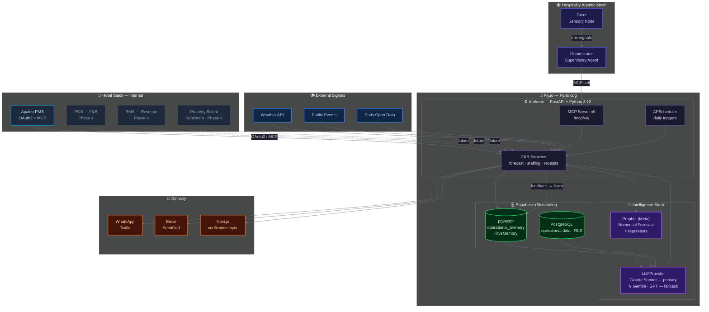

<h1 align="center">Aetherix</h1>
<p align="center">
  <em>F&B Execution Node of the Hospitality Agentic Mesh.</em>
</p>

<p align="center">
  
  
  
  
  
  
  
</p>

---

## What is Aetherix

Aetherix is a **Proactive Contextual Agentic Layer for F&B Operations**. It is the **F&B operations node** of the Hospitality Agentic Mesh: a platform of specialized contextual AI agents layers delivering intelligence and communicating via MCP (Model Context Protocol).

It handles one domain with precision: **forecasting F&B covers, optimizing staffing, and delivering actionable recommendations** to hotel managers via WhatsApp. It learns from each property's history, adapts continually through manager feedback, and exposes its capabilities as MCP tools callable by any orchestration agent.

**Aetherix does not orchestrate. It recommends. The manager validates**

The separation is intentional: each node (agent) in the Mesh (hive) has a strict bounded context. Aetherix owns F&B. An Orchestrator decides when to call it.

---

## The Hospitality Agentic Mesh

Aetherix is one node in a broader architecture designed to replace rigid hotel tech monoliths with composable, MCP-native agents:

```
┌─────────────────────────────────────────────────────────┐
│                 Hospitality Agentic Mesh                │
│                                                         │
│   ┌─────────────┐    MCP calls     ┌─────────────────┐  │
│   │  Tacet      │ ──────────────→  │   Orchestrator  │  │
│   │ Sensory Node│  room_risk_score │ Supervisory Agent│ │
│   │ (env data)  │                  │  (routes, rules) │ │
│   └─────────────┘                  └────────┬────────┘  │
│                                             │           │
│   ┌─────────────┐    MCP calls             │            │
│   │  Apaleo PMS │ ──────────────→          │            │
│   │  Commerce   │  inventory, occ.          │           │
│   │  Hub        │                           ▼           │
│   └─────────────┘             ┌─────────────────────┐   │
│                                │   Aetherix          │  │
│                                │   F&B Execution Node│  │
│                                │   (this repo)       │  │
│                                └──────────┬──────────┘  │
│                                           │             │
│   ┌─────────────┐                         │ WhatsApp    │
│   │   Anima     │    Phase 4              ▼             │
│   │   Guest     │ ──────────→   Hotel Manager           │
│   │  Context    │                                       │
│   │   Node      │                                       │
│   └─────────────┘                                       │
└─────────────────────────────────────────────────────────┘
```

| Node | Role | Status |
|------|------|--------|
| **Aetherix** | F&B execution — forecast, staffing, memory, receipts | ✅ Live (staging) |
| **Tacet** | Environmental signals — weather, noise, open data → scores | 🔨 Phase 3 |
| **Orchestrator** | Supervisory agent — MCP routing, business rules, agentic loop | 📐 Phase 3 stub |
| **Anima** | Guest context — emotional state, CRM, flight delays → profile | 📋 Phase 4 |

---

## Why it exists

Hotels waste ~25% of the food they produce. Labor costs represent 30–45% of F&B operating expenses. Daily staffing decisions remain manual, repetitive, and error-prone — made by gut feel at 8am with no data.

**Key insight:** The bottleneck is not data — hotels have PMS data. The bottleneck is synthesis: combining occupancy, weather, local events, and property-specific capture rates into a recommendation that actually fits *this* hotel's reality.

Aetherix builds that synthesis automatically, learns from manager feedback, and delivers it where managers already work — WhatsApp, not another dashboard.

**Goal:** Reduce food waste and labor inefficiencies while giving managers more time to focus on their guests.

---

## What Aetherix does

### Delivered (May 2026)

- **Daily F&B forecast** — Prophet time-series + occupancy regressors (weather, events, occupancy). MAPE 7.8% J+1 on backtest.
- **Staffing recommendations** — covers → optimal headcount, respecting labor regulations
- **Daily Receipt** — WhatsApp push at 6am: yesterday's actuals vs forecast, delta, confidence
- **Weekly digest** — Sunday KPI summary: acceptance rate, MAPE trend, cost variance
- **Feedback loop** — managers reply "accepted / rejected / modified" → memory update → next forecast improves
- **MCP Server v0** — 3 tools exposed at `/mcp/v0/`: `get_operational_predictions`, `get_recommendations_with_memory_context`, `submit_feedback_to_memory`
- **Apaleo integration** — native OAuth2 + MCP read (occupancy, reservations, historical data)

### MCP Tools (callable by any agent)

```json
get_operational_predictions(target_date, service_type, context)
  → { prediction: { covers, confidence }, staffing, reasoning }

get_recommendations_with_memory_context(query, target_date, k_memory)
  → { recommendation, confidence, memory_hits, reasoning_summary }

submit_feedback_to_memory(recommendation_id, outcome, notes)
  → { memory_id, status }
```

> **v1 (in progress — ADR-0004):** `get_recommendations_with_memory_context` will be split into two atomic tools — `recall_memory` and `get_operational_predictions` — so an Orchestrator can compose them with full visibility into intermediate results.

Authentication: bearer token per hotel. `hotel_id` is never a tool parameter — resolved server-side from the token (multi-tenant isolation by design).

---

## Architecture

### Intelligence stack (internal to Aetherix)



**Internal vs external context.** The Hotel Stack groups the property's own operational systems — high trust, GDPR scope is the hotel's own. External Signals are third-party data sources that contextualize demand. Future internal integrations (POS for actual consumption, RMS for room revenue context, Property Social Sentiment for guest-expressed feedback) form a complete operational picture: *what they booked · what they consumed · what they spent · what they felt*.

### Tech stack

| Layer | Technology | Notes |
|-------|-----------|-------|
| Backend | FastAPI + Python 3.12 | Async, Pydantic v2 |
| Forecast | Prophet (Meta) | Time-series + weather/event regressors |
| Memory | pgvector (Supabase) | Mistral 1024d embeddings, HNSW index |
| LLM | Claude Sonnet | Reasoning + explainability. Multi-LLM via `LLMProvider` abstraction |
| Cache | Redis (Upstash) | Session state, rate limiting |
| PMS | Apaleo | OAuth2 + MCP read |
| Delivery | WhatsApp (Twilio) + Email (SendGrid) | Push-first, inbound feedback parser |
| Deploy | Fly.io (Paris, cdg) | 1 always-on instance, Docker + uv multi-stage |
| Database | Supabase (PostgreSQL) | RLS on 14 tables, Stockholm region |

### Project structure

```
aetherix/
├── backend/
│   ├── app/
│   │   ├── api/             # HTTP routes (auth, pms, predictions, receipts)
│   │   ├── db/              # SQLAlchemy models + Supabase session
│   │   ├── services/        # F&B execution: forecast, staffing, memory, receipts, WhatsApp
│   │   ├── providers/       # LLM + Embedding abstraction (Claude, Mistral, Gemini, fallback)
│   │   ├── integrations/    # Apaleo, Twilio, SendGrid, Linear, Obsidian
│   │   ├── middleware/       # Agent tracking, request_id
│   │   └── mcp_server.py    # MCP Server v0 — 3 tools
│   └── orchestrator/        # Proto-orchestrator (Phase 3, in progress — ADR-0004)
├── docs/
│   ├── adr/                 # Architecture Decision Records (0001–0004)
│   ├── mesh-architecture.md # Cross-repo source of truth: full Mesh vision
│   ├── planning/            # Phase roadmaps
│   └── context/             # Domain context, conventions, memory architecture
├── scripts/
│   ├── ci/                  # Schema drift gate, RLS audit, smoke tests
│   └── ops/                 # Backtest, Prophet training, veille
├── supabase/                # DB migrations
└── archive/                 # Legacy pre-FastAPI code — not used in production
```

---

## Current status (May 2026)

| Gate | Result |
|------|--------|
| Forecasting harness (Prophet + regressors) | ✅ Built — backtest pipeline ready |
| MAPE J+1 real-world measurement | 🔨 Pending — first run on design partner data |
| MCP Server v0 | ✅ Shipped — `/mcp/v0/`, 3 tools |
| Staging deploy | ✅ Live — `aetherix-backend.fly.dev` |
| Apaleo integration | ✅ OAuth2 + MCP read |
| Daily Receipt + WhatsApp | ✅ End-to-end |
| RLS security | ✅ 14/14 tables |
| First design partner | 🔨 Phase 3 in progress |
| Orchestrator separation | 🔨 ADR-0004, in progress |

---

## Memory architecture

Aetherix uses a two-layer memory system:

**Private Memory (per-hotel)** — `operational_memory` table in pgvector. Stores manager feedback, outcomes, and patterns specific to each property. Used to personalize every recommendation.

**HiveMemory (cross-hotel)** — anonymized pattern aggregation across properties (k-means clustering + LLM persona generation). Hotels learn from each other without sharing raw data. Phase 3 Track B.

---

## Evaluation by design

Aetherix treats evaluation as a contract, not an afterthought.

**The reliability bar.** *"Working"* is proven on a test set. *"Reliable"* is proven in production. Five dimensions, checked before every ship:

| Dimension | Question we answer before merge |
|---|---|
| **Edge behavior** | Did we test out-of-distribution inputs — or only the happy path? |
| **Graceful degradation** | Does the agent say *"I don't know"* explicitly when uncertain — or does it improvise? |
| **Observability** | Can we see in production what the model actually does? |
| **Reproducibility** | Same input tomorrow → same output? |
| **Distribution shift resilience** | Are we alerted if production inputs drift from training data? |

**The contract.** A versioned golden dataset (`eval/golden_dataset.jsonl`) and per-layer failure thresholds (`eval/FAILURE_THRESHOLDS.md`) define what *"bad output"* means before code is written. Any change to forecast services, providers, memory, or prompts requires updated examples + green eval pipeline before merge — CI gate, alongside the schema drift gate.

**Inspiration.** Framework adopted from Qonto's *"AI @ Qonto: shipper et évaluer l'IA en production"* (Marianne Borzic Ducournau, Head of AI Products). Cited and extended for Aetherix's PMS+POS-aware F&B forecasting context. Detailed REX (retour d'expérience) article coming end of Phase 3.

---

## Security

| Area | Approach |
|------|----------|
| Multi-tenant isolation | `hotel_id` scoped at every layer: Supabase RLS, Python guards, MCP token binding. No cross-hotel data access. |
| MCP auth | Opaque bearer tokens per hotel. `hotel_id` resolved server-side — never accepted as tool input. |
| PMS access | Read-only (Apaleo Phase 0). No writes to reservations or guest records. All agent actions logged. |
| LLM scoping | Claude prompts scoped per property. Manager replies sanitized against prompt injection. |
| Secrets | `flyctl secrets set` — never committed. Webhook signatures validated (Twilio HMAC). |
| GDPR | Supabase EU (Stockholm). HiveMemory = anonymized aggregates only — no raw hotel data shared cross-tenant. |

---

## Roadmap

| Phase | Status | Highlights |
|-------|--------|------------|
| Phase 0 — Validation harness | 🔨 In Progress | Backtest pipeline · ROI simulator · MCP Server v0 — real-world MAPE measurement pending |
| Phase 1 — Observability | ✅ Done | agent_action_log · Redis rate-limiter · HiveMemory instrumentation |
| Phase 0 deploy | ✅ Done | Fly.io staging live · RLS 14/14 · webhook HMAC |
| Phase 2 — Receipts | ✅ Done | Daily Receipt · WhatsApp · inbound feedback · weekly digest |
| Phase 3 — Pilot | 🔨 In Progress | Design partner (Apaleo prod) · Orchestrator separation · HiveMemory algorithm · Article technique Mesh |
| Phase 4 — Scale | 📋 Planned | Mews integration · POS/RMS/Social Sentiment ingestion · Anima (Guest Context Node) · Orchestrator repo |

Full roadmap: [Linear — Hospitalityagent](https://linear.app/hospitalityagent/team/HOS/all)

Mesh architecture: [`docs/mesh-architecture.md`](docs/mesh-architecture.md)

---

**Built with ❤️ for hotels, restaurants, and those who love them by Ivan de Murard**
